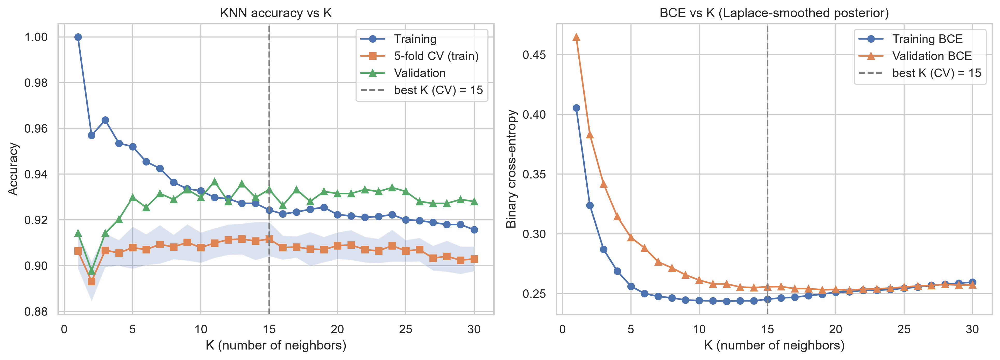
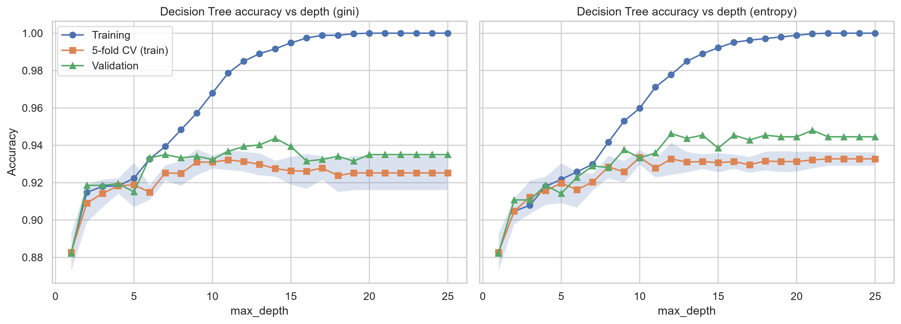
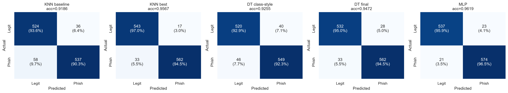
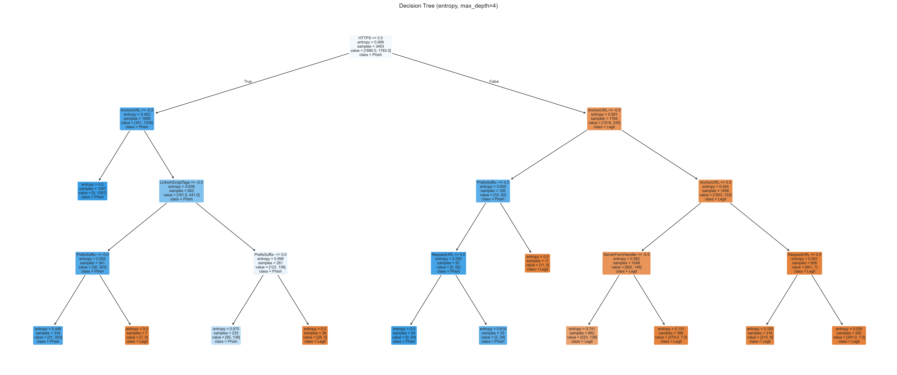

# Task-01: تشخیص سایت‌های فیشینگ با KNN و Decision Tree

دیتاست UCI Phishing Websites رو برداشتم (`phishing.csv`، ۱۱٬۰۵۴ نمونه و ۳۰ ویژگی با مقدار -1 و 0 و 1) و دو مدل KNN و Decision Tree رو روی اون مقایسه کردم. برچسب رو طوری گذاشتم که `y = 1` یعنی فیشینگ. تنظیمات هر دو مدل فقط با 5-fold CV روی داده‌ی آموزش انتخاب می‌شه و مجموعه‌ی تست فقط یک بار، آخر کار، باز می‌شه. یه MLP هم اضافه کردم، فقط برای اینکه منحنی loss و accuracy بر حسب epoch داشته باشم.

منبع داده: R. Mohammad and L. McCluskey, UCI Machine Learning Repository, DOI 10.24432/C51W2X (CC BY 4.0).

## دو پیاده‌سازی

این تسک رو دو بار با یک پروتکل (ادغام تکراری‌ها، تقسیم ۶۰/۲۰/۲۰ طبقه‌ای، انتخاب مدل فقط با CV، تست یک بار) نوشتم: یکی هشت‌مرحله‌ای (`step01` تا `step07` + `common.py`) و یکی تک‌فایلی (`ml_task01.py`).

| | چندمرحله‌ای | تک‌فایلی |
|---|---|---|
| اجرا | هر مرحله یک اسکریپت، به ترتیب | یک دستور |
| ردوبدل بین مراحل | فایل CSV/JSON در `outputs/data` | ندارد |
| خروجی | `outputs/` | `outputs_compact/` |
| EDA | همبستگی، mutual information، heatmap سطوح | فقط توزیع کلاس‌ها |
| KNN | K روی raw و dedup، چهار metric (با Chebyshev)، وزن، scaling، انتخاب ویژگی، ۴ بازنمایی، گرید ۱۶۲تایی، منحنی یادگیری | K روی dedup، ۴ بازنمایی، گرید ۱۶۲تایی (Euclidean، Manhattan، Hamming) |
| Decision Tree | baseline، عمق، گرید criterion × عمق × برگ، pruning، بازنمایی‌ها، اهمیت ویژگی، منحنی یادگیری | عمق، pruning، ۴ بازنمایی، عمق‌های ۳/۴/۱۰/نامحدود، درخت عمق ۴ |
| مدل‌های تست | ۷ تا | ۵ تا |
| آزمون و بازه | بوت‌استرپ (Acc، F1، AUC)، McNemar روی ۶ جفت، leave-one-out | بوت‌استرپ (Acc، F1)، McNemar روی ۳ جفت |
| اهمیت ویژگی | دارد | ندارد |
| لاگ | یکی برای هر مرحله | یک `run.log` |

مزیت نسخه‌ی چندمرحله‌ای اینه که هر مرحله جدا قابل اجراست و نتایج مراحل قبل ذخیره می‌مونه، هر آزمایش لاگ و جدول و شکل خودش رو داره، و آزمایش‌های بیشتری داره (scaling، انتخاب ویژگی، Chebyshev، منحنی یادگیری، اهمیت ویژگی، PR، leave-one-out). مزیت تک‌فایلی اینه که با یک دستور همه‌ی اعداد گزارش بازتولید می‌شه و به فایل مرحله‌ی قبل نیازی نداره. برای مدل‌هایی که هر دو دارن، نتیجه‌ی تست دقیقاً یکیه.

## ساختار خروجی (تک‌فایلی)

```
ml_task01.py
phishing.csv
outputs_compact/
  run.log          # تنظیمات انتخاب‌شده و معیارهای تست
  figures/         # fig01 تا fig08 (.png و .pdf)
  tables/          # هر جدول به صورت .csv + mlp_history.csv + test_predictions.csv
  tex/             # همون جدول‌ها به صورت tabular لاتک
```

| شکل | محتوا |
|---|---|
| `fig01_class_distribution` | تعداد کلاس‌ها |
| `fig02_knn_vs_k` | دقت و BCE مدل KNN بر حسب K |
| `fig03_dt_vs_depth` | دقت درخت بر حسب عمق (gini و entropy) |
| `fig04_dt_depth_confusion` | ماتریس درهم‌ریختگی validation برای عمق ۳، ۴، ۱۰ و نامحدود |
| `fig05_tree_depth4` | درخت entropy با عمق ۴ |
| `fig06_mlp_curves` | BCE و accuracy بر حسب epoch |
| `fig07_test_confusion` | ماتریس درهم‌ریختگی تست همه‌ی مدل‌ها |
| `fig08_test_roc` | منحنی ROC تست |

جدول‌ها: `data_sample`، `split_summary`، `leakage_effect`، `knn_k_sweep`، `knn_representations`، `knn_grid_top10`، `knn_factors`، `dt_representations`، `dt_depth_compare`، `test_metrics`، `test_bootstrap_ci`، `mcnemar`، `hyperparameters`.

## توضیح کد، بلاک به بلاک

### ۰. بازنمایی ویژگی‌ها و ارزیابی

همه‌ی مدل‌ها با دو تابع مقایسه می‌شن. `make_rep` ویژگی‌ها رو به یکی از چهار شکل درمیاره: `ordinal` (همون -1/0/1)، `onehot` (هر ویژگی سه‌مقداری می‌شه سه ستون صفر و یک) و `merge0_neg` / `merge0_pos` (مقدار ۰ ادغام می‌شه با -1 یا +1).

```python
if mode == "onehot":      # 8 ternary features -> 3 indicators each
    def f(X):
        out = X.drop(columns=TERN).copy()
        for c in TERN:
            for v in (-1, 0, 1):
                out[f"{c}={v}"] = (X[c] == v).astype(int)
        return out
    return f
```

`evaluate` هم میانگین و انحراف 5-fold CV روی train رو برمی‌گردونه و دقت validation رو فقط برای گزارش حساب می‌کنه:

```python
def evaluate(est, A, y_tr, B, y_va):
    cv = cross_val_score(est, A, y_tr, cv=CV, scoring="accuracy")
    return dict(cv_mean=cv.mean(), cv_std=cv.std(),
                val_acc=accuracy_score(y_va, clone(est).fit(A, y_tr).predict(B)))
```

### ۱. داده

برچسب `class == -1` می‌شه `y = 1` (فیشینگ). بعدش نمونه‌های با بردار ویژگی یکسان رو گروه می‌کنم و با رأی اکثریت یکی می‌کنم؛ گروهی که نصف‌نصف باشه حذف می‌شه.

```python
g = df.groupby(FEATS)["y"].agg(n_rows="size", n_phish="sum").reset_index()
ties = g.n_phish * 2 == g.n_rows
g = g[~ties].copy()
g["y"] = (g.n_phish * 2 > g.n_rows).astype(int)       # majority vote
```

تقسیم ۶۰/۲۰/۲۰ طبقه‌ای با seed ثابت انجام می‌شه، هم روی داده‌ی خام و هم روی داده‌ی بدون تکراری. `leak` نشون می‌ده چند درصد از نمونه‌های validation/test بردار مشابهشون توی train هست (روی داده‌ی خام حدود ۵۸٪ و ۵۶٪، روی بدون‌تکراری صفر):

```python
def leak(d, s):
    h, m = pd.util.hash_pandas_object(d[FEATS], index=False).values, d["subset"].values
    return float(np.isin(h[m == s], h[m == "train"]).mean())
```

### ۲. KNN

اول جاروی K از ۱ به بالا، با دقت train/CV/validation و BCE. چون KNN احتمال نداره، احتمال رو با هموارسازی Laplace از رأی همسایه‌ها درمیارم:

```python
lap = lambda X, y: float(log_loss(y, (m.predict_proba(X)[:, 1] * k + 1) / (k + 2), labels=[0, 1]))
```

همین جاروی K رو یک بار هم روی داده‌ی خام می‌گیرم و جدول `leakage_effect` درمیاد: تکراری‌ها K=1 رو الکی خوب نشون می‌دن. بعدش چهار بازنمایی رو مقایسه می‌کنم و سه‌تای برتر وارد گرید مشترک می‌شن (بازنمایی × metric × وزن × K). انتخاب فقط با میانگین CV انجام می‌شه و اگه مساوی بودن، انحراف کمتر و بعد K بزرگ‌تر:

```python
for r in top_reps:
    f = make_rep(r, Xtr)
    A, B = f(Xtr), f(Xva)
    for metric in ("euclidean", "manhattan", "hamming"):
        for w in ("uniform", "distance"):
            for k in K_GRID:
                rows.append(dict(representation=r, metric=metric, weights=w, K=k,
                                 **evaluate(knn(k, metric, w), A, ytr, B, yva)))
grid = pd.DataFrame(rows).sort_values(["cv_mean", "cv_std", "K"], ascending=[False, True, False])
```

شکل `fig02_knn_vs_k` خروجی همین بلاکه.



### ۳. Decision Tree

اول عمق از ۱ تا ۲۵ برای gini و entropy:

```python
rows = [dict(criterion=c, depth=d, leaves=(m := dt(criterion=c, max_depth=d).fit(Xtr, ytr)).get_n_leaves(),
             train_acc=accuracy_score(ytr, m.predict(Xtr)),
             **evaluate(dt(criterion=c, max_depth=d), Xtr, ytr, Xva, yva))
        for c in ("gini", "entropy") for d in range(1, 26)]
```

نمودار این جارو `fig03_dt_vs_depth` هست.



بعد با criterion انتخاب‌شده، مسیر cost-complexity pruning رو می‌گیرم (۶۰ مقدار alpha) و بهترین حالت عمق‌محور رو با بهترین حالت pruning مقایسه می‌کنم. برنده بالاترین CV داره و اگه مساوی بود، درخت با برگ کمتر:

```python
alphas = np.unique(dt(criterion=crit).cost_complexity_pruning_path(Xtr, ytr).ccp_alphas)[:-1]
KW = sorted(cands, key=lambda c: (-c[0], c[1]))[0][2]
```

بعدش درخت انتخاب‌شده روی چهار بازنمایی امتحان می‌شه. در آخر هم درخت‌های عمق ۳ و ۴ و ۱۰ و نامحدود با ماتریس درهم‌ریختگی روی validation (`fig04`) و درخت عمق ۴ (`fig05`) رسم می‌شن.

### ۴. MLP

با `partial_fit` هر بار فقط یک epoch آموزش می‌دم و BCE و accuracy رو روی train و validation ذخیره می‌کنم. epochی که کمترین BCE validation رو داره نگه داشته می‌شه:

```python
for ep in range(1, N_EPOCHS + 1):
    m.partial_fit(Otr, ytr, classes=np.array([0, 1]))
    ptr, pva = m.predict_proba(Otr)[:, 1], m.predict_proba(Ova)[:, 1]
    hist.append(dict(epoch=ep, train_bce=bce(ytr, ptr), val_bce=bce(yva, pva),
                     train_acc=accuracy_score(ytr, ptr >= 0.5), val_acc=accuracy_score(yva, pva >= 0.5)))
E_STAR = int(H.loc[H.val_bce.idxmin(), "epoch"])
```

`bce` احتمال‌ها رو clip می‌کنه، چون برگ‌های خالص درخت دقیقاً ۰ یا ۱ می‌دن و لگاریتم بی‌نهایت می‌شه.

### ۵. ارزیابی نهایی روی تست

اینجا تست برای اولین و آخرین بار باز می‌شه. هر مدل با تنظیماتی که قبلاً با CV انتخاب شده روی train+validation دوباره آموزش می‌بینه و تست یک بار امتیاز می‌گیره (MLP هم تا `E_STAR` epoch):

```python
fit = pd.concat([P["train"], P["val"]], ignore_index=True)
SPECS = {"KNN baseline": ("ordinal", KNeighborsClassifier(n_neighbors=1)),
         "KNN best": (kcfg["rep"], knn(kcfg["K"], kcfg["metric"], kcfg["weights"])),
         "DT class-style": ("ordinal", dt(criterion="entropy", max_depth=4)),
         "DT final": (REP, dt(**KW))}
```

بعدش جدول معیارها (با خطای train و test)، بازه‌ی اطمینان ۹۵٪ با ۲۰۰۰ نمونه‌گیری بوت‌استرپ و آزمون دقیق McNemar روی پیش‌بینی‌های جفتی ساخته می‌شه:

```python
BOOT = rng.integers(0, len(yte), size=(N_BOOT, len(yte)))
...
p = binomtest(na, na + nb, 0.5).pvalue        # McNemar exact
```

خروجی آخر `fig07_test_confusion` (ماتریس درهم‌ریختگی تست همه‌ی مدل‌ها) و `fig08_test_roc` هست.



## نتایج تست

| مدل | Accuracy | Precision | Recall | F1 | ROC-AUC |
|---|---|---|---|---|---|
| KNN baseline (k=1، Euclidean، ordinal) | 0.9186 | 0.9372 | 0.9025 | 0.9195 | 0.9191 |
| KNN best (one-hot، Hamming، distance، K=9) | 0.9567 | 0.9706 | 0.9445 | 0.9574 | 0.9933 |
| DT class-style (entropy، عمق ۴) | 0.9255 | 0.9321 | 0.9227 | 0.9274 | 0.9756 |
| DT final (entropy، pruned، one-hot) | 0.9472 | 0.9525 | 0.9445 | 0.9485 | 0.9677 |
| MLP (۴۵ epoch) | 0.9619 | 0.9615 | 0.9647 | 0.9631 | 0.9938 |

درخت تصمیم:


## اجرا

```bash
# تک‌فایلی
python ml_task01.py phishing.csv

# چندمرحله‌ای، به همین ترتیب
python step01_env_eda.py
python step02_preprocess.py
python step03_knn_baseline.py
python step04_knn_experiments.py
python step05_decision_tree.py
python step06_final_evaluation.py
python step07_importance_and_tex.py
```

نیازمندی‌ها: Python 3، numpy، pandas، scipy، scikit-learn، matplotlib، seaborn.
